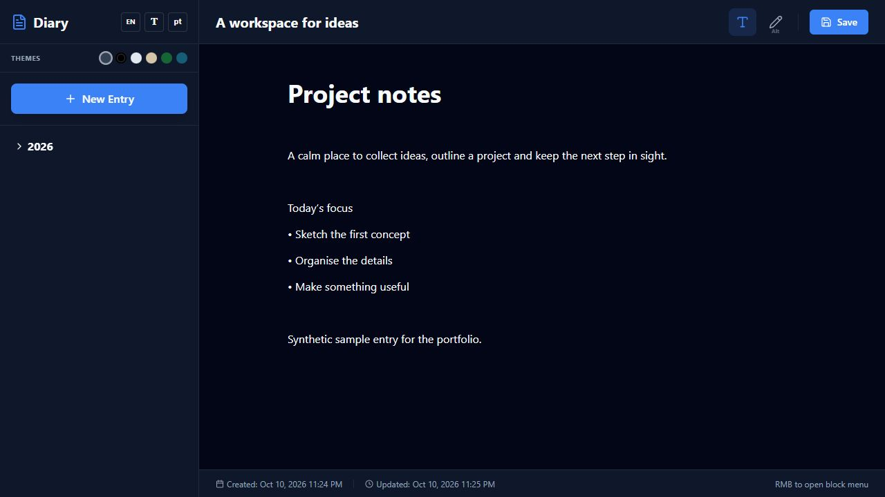

# Diary

**A local-first writing workspace with rich text, sketches and a choice of themes.**

[Open the browser demo](https://snowganter.github.io/diary/) · [Source code](https://github.com/SnowGanter/diary)



## Write in your own way

- Create entries and organise them by date.
- Format text with headings, lists, quotes, code, links and tables.
- Add sketches and draw over an entry.
- Work with columns, tabs, checklists, boards and gallery blocks.
- Choose a theme, font and text size.
- Switch between Russian, English, German, Spanish and Hebrew, including right-to-left layout.

Built with **React, Vite, Tailwind CSS and IndexedDB**, with an Electron wrapper for the Windows desktop version.

## Your entries stay in this browser

The GitHub Pages edition runs entirely in the browser and stores entries in IndexedDB. It starts empty; the repository and screenshots contain no personal diary entries. Different devices and browser profiles have separate data. Clearing site storage removes saved entries. The current release requires the **Save** button and does not include cloud sync, encryption or an export/backup feature.

An optional Firebase adapter remains in the source for a configured sandbox environment. No Firebase project, credentials or backend are supplied or enabled by the public Pages build.

## Run locally

Requires Node.js 22 or newer.

```bash
git clone https://github.com/SnowGanter/diary.git
cd diary
npm ci
npm run dev
```

```bash
npm run build
npm run preview
```

For a Windows installer:

```powershell
npm run build-exe
```

The Electron renderer runs without Node integration, with context isolation and sandboxing enabled. This repository does not provide a signed installer.

## GitHub Pages

`.github/workflows/pages.yml` builds the app with the `/diary/` base path and deploys the static `dist` output. Pages uses **GitHub Actions** as its source. Publishing updates the application files; it does not upload a visitor's IndexedDB entries.

## Project context

A personal product and portfolio project developed with AI assistance. It demonstrates an interactive editor, browser persistence, multilingual controls and desktop packaging. Screenshots use a synthetic sample entry for presentation, not real personal content. No client metrics or production guarantees are claimed.

## Source layout

```text
src/App.jsx       Editor, blocks, themes, language controls and storage adapter
src/index.css     Shared styling
public/           Application icons
main.cjs          Electron desktop wrapper
vite.config.js    Web build configuration
.github/workflows/pages.yml
```
