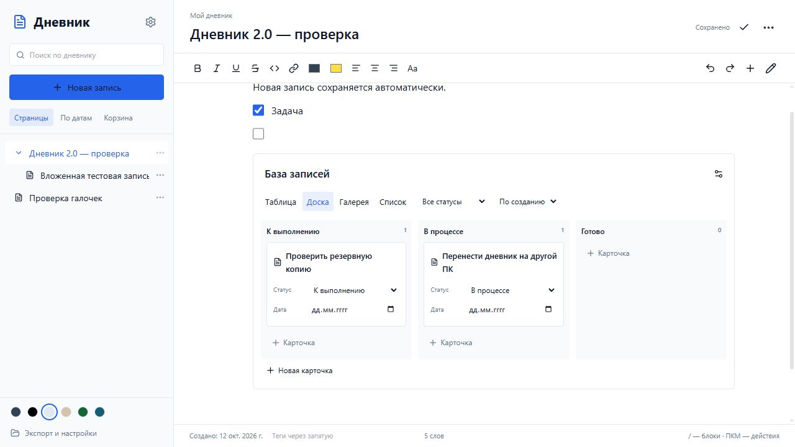
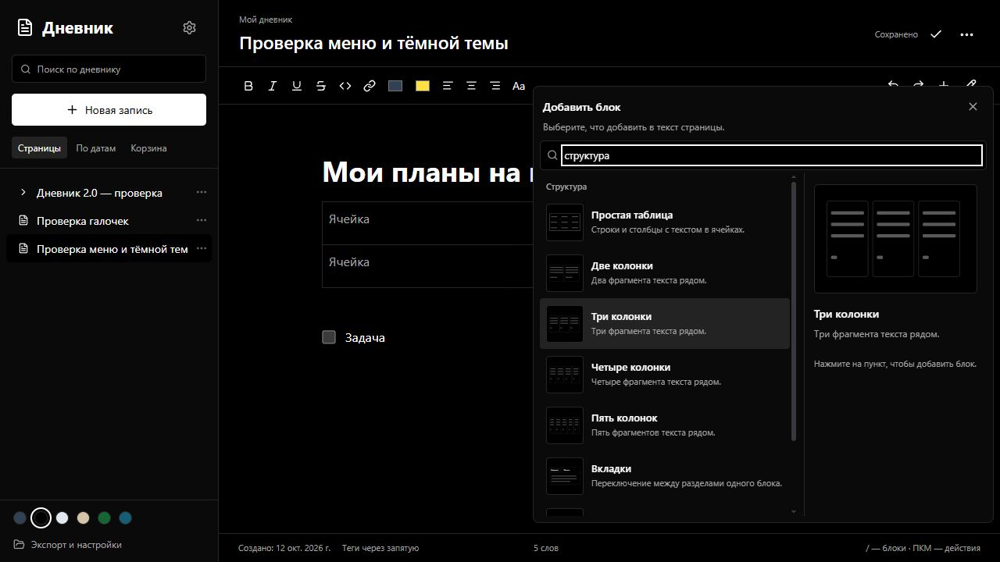

# Дневник / Diary 2.0

Личный дневник для Windows с блочным редактором, карточками и отдельной папкой данных. Работает без учётной записи и подключения к интернету. Есть браузерная версия для GitHub Pages.

[Скачать Windows-приложение](https://github.com/SnowGanter/diary/releases/latest) · [Браузерная версия](https://snowganter.github.io/diary/) · [Изменения](CHANGELOG.md)



## Возможности

- Автосохранение, сохранение перед переключением страниц и закрытием окна, видимый статус и повтор при ошибке.
- Вложенные страницы, избранное, поиск по тексту и карточкам, теги, группировка по датам, блокировка редактирования, корзина с восстановлением дерева страниц.
- Текст, заголовки, списки и галочки, раскрывающиеся блоки, цитаты, код, разделители, простые таблицы, колонки, вкладки, оглавление и ссылки на страницы.
- Добавление через `/`, меню по правой кнопке мыши, перетаскивание, дублирование, перенос на другую страницу, преобразование, копирование с форматированием, отмена и повтор.
- Визуальные миниатюры блоков в меню и увеличенный пример выбранного пункта. Поиск, выбор стрелками и вставка через `Enter`.
- Базы карточек с представлениями «Таблица», «Доска», «Галерея» и «Список». У карточек есть название, описание, статус, дата и дополнительные текстовые, числовые, календарные поля и галочки. Есть фильтр по статусу, сортировка и перенос карточек между колонками доски.
- Изображения, файлы, закладки, скетчи и рисование поверх страницы. Вложения Windows-версии сохраняются отдельными файлами.
- Шесть тем, выбор шрифта и размера текста. Существующие переводы редактора сохранены; новые элементы управления пока преимущественно на русском.
- История страницы, ежедневные резервные копии, экспорт дневника и отдельной страницы.

## Запуск и перенос



Скачайте файл в [Releases](https://github.com/SnowGanter/diary/releases/latest):

- `Diary-Setup-2.0.1.exe` — установщик Windows x64.
- `Diary-Portable-2.0.1.exe` — запуск без установки. Положите его в папку, в которую разрешена запись. При первом запуске рядом появится `DiaryData`.

У установленной версии папка по умолчанию находится в **Документы / My Diary / DiaryData**. Точный путь показан в «Хранилище и настройки». Там можно создать хранилище в пустой папке или открыть существующее.

Для переноса:

1. Закройте дневник и дождитесь завершения сохранения.
2. Скопируйте **всю** папку `DiaryData` на другой компьютер.
3. В приложении выберите «Хранилище и настройки → Открыть хранилище» и укажите скопированную папку.

Переносимую версию можно переносить вместе с `DiaryData` и `diary-location.json`. Последний хранит относительный путь к выбранному хранилищу. Не открывайте одну папку одновременно на двух компьютерах.

```text
DiaryData/
  workspace.json       # формат и идентификатор
  settings.json        # оформление
  pages/<id>.json      # страницы, HTML и метаданные блоков
  assets/<hash>.<ext>   # изображения, файлы и рисунки
  backups/             # архивы и история страниц
```

Ссылки на вложения не содержат абсолютного пути к компьютеру. Одинаковые вложения сохраняются один раз. Запись страницы заменяет файл атомарно. В истории Windows-версии остаются последние 30 предыдущих версий страницы. Ежедневный архив создаётся перед первым сохранением за день. В меню страницы можно восстановить предыдущую версию.

## Старые записи и архивы

При первом запуске Windows-версии записи из старого IndexedDB переносятся в новое файловое хранилище. Перед переносом создаётся `backups/legacy-*.json`; старый IndexedDB не удаляется. Перенос выполняется один раз для профиля. Если использовался другой профиль, записи можно перенести через экспорт старой версии.

Windows-версия экспортирует `.diary` со страницами, настройками и вложениями. Импорт объединяет страницы по идентификаторам и не заменяет более новую страницу старой. До импорта создаётся резервный архив. История включается при копировании папки, но не входит в экспорт `.diary`.

Браузер хранит записи в IndexedDB этого браузера и экспортирует `.json`. Его можно импортировать в другой браузер или Windows-приложение. Браузер не читает `.diary` и не получает доступ к папке Windows автоматически. Рисование поверх страницы входит в полный архив и перенос папки. Экспорт отдельной страницы в HTML сохраняет текст, вложения и описание карточек, но не отдельный слой рисования.

## Горячие клавиши

| Действие | Клавиши |
| --- | --- |
| Сохранить | `Ctrl+S` |
| Отменить / повторить в редакторе | `Ctrl+Z` / `Ctrl+Shift+Z` или `Ctrl+Y` |
| Меню вставки в начале блока | `/` |
| Рисование поверх страницы | `Ctrl+Shift+D` |
| Закрыть меню | `Esc` |

## Разработка

Нужны Node.js 22.12+ и npm. Windows-сборка рассчитана на x64.

```sh
npm ci
npm run dev                # редактор в браузере
npm run build
npm run dev-desktop        # Electron с собранным редактором
npm run lint
npm test                   # хранилище, миграция, архивы, история
npm run test:desktop       # изолированная проверка Electron
npm run build-exe          # два exe в release/
```

Если предыдущая сборка открыта или заблокирована:

```sh
npm run build-exe -- --config.directories.output=release/v2.0.1
```

Проверка упакованного приложения после сборки (PowerShell):

```powershell
$env:DIARY_PACKAGED_ROOT = (Resolve-Path 'release/v2.0.1/win-unpacked/resources/app.asar').Path
npm run test:desktop
Remove-Item Env:DIARY_PACKAGED_ROOT
```

Проверка создаёт отдельные данные в `.test-data/`; личный дневник не открывается. В Git попадают исходники, готовые `.exe` публикуются в Releases.

## Дальнейшее развитие

Это локальный дневник с основными возможностями блочного редактора и простыми базами карточек. Полного соответствия всем функциям Notion пока нет. Формулы, связи баз, календарь, синхронизация, совместное редактирование и полная локализация остаются в [плане развития](docs/ROADMAP.md). Данные хранятся открытым текстом; блокировка страницы предотвращает случайное редактирование и не является паролем.
